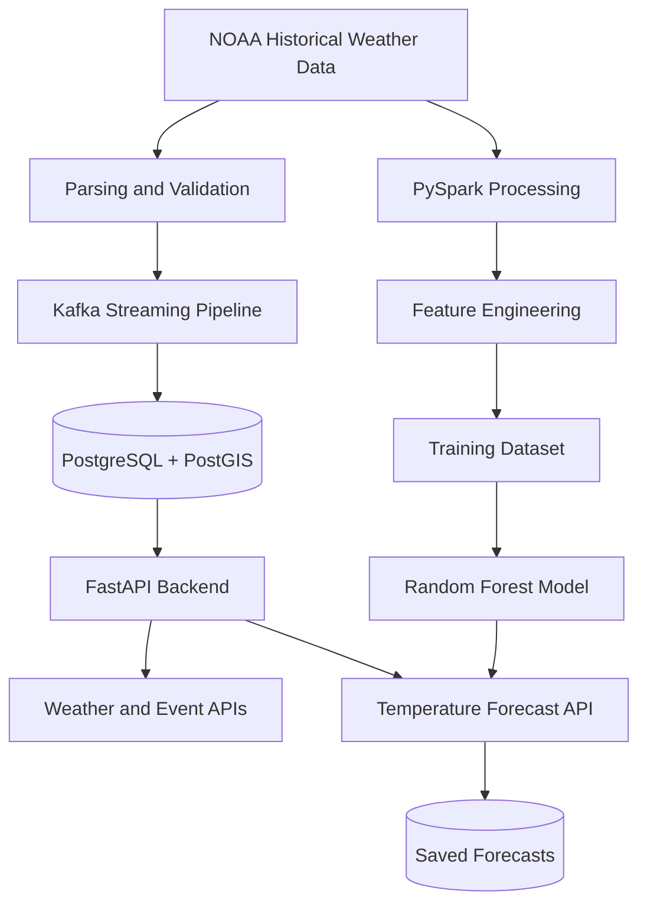

# 🌦️ WeatherSentinel

### National Weather Intelligence, Verification & Analytics Platform

WeatherSentinel is a personal project I'm building to explore how weather data can be collected, processed, verified, and turned into useful insights using data engineering and machine learning.

The idea is simple: weather data comes from different sources and in different formats. I want to bring that data into one platform where it can be processed, analyzed, and eventually used to identify important weather events and generate short-term forecasts.

I'm building WeatherSentinel step by step, focusing on the backend, data pipelines, geospatial data, and machine learning before moving toward a more complete weather intelligence dashboard.

**Project status:** Actively under development.

---

## 🌍 What I'm trying to build

My goal is to develop a platform that connects the different parts of a weather intelligence system—from raw weather observations to APIs and machine learning predictions.

Some of the main things I'm working on are:

- Collecting and processing historical weather observations.
- Cleaning and standardizing weather data from different sources.
- Using Kafka to move weather observations through a streaming pipeline.
- Storing observations and location information in PostgreSQL and PostGIS.
- Detecting potentially important weather conditions using configurable rules.
- Building PySpark pipelines for feature engineering and dataset preparation.
- Training machine learning models to predict temperature three hours ahead.
- Exposing weather information and predictions through FastAPI.

The long-term goal is to extend these components into a unified platform for weather analytics and geospatial intelligence. There is still work to do before that vision becomes a complete, production-ready system.

## 🛠️ Technology I'm using

| Area | Technologies |
|---|---|
| Programming | Python |
| Backend | FastAPI, Uvicorn |
| Database | PostgreSQL, SQLAlchemy, Alembic |
| Geospatial | PostGIS |
| Streaming | Apache Kafka |
| Data engineering | Apache Spark, PySpark |
| Machine learning | scikit-learn, NumPy, Joblib |
| API documentation | OpenAPI, Swagger UI |
| Version control | Git and GitHub |

## 🏗️ How the system works

At a high level, WeatherSentinel has two connected workflows: one for processing weather data and another for training and serving temperature predictions.



This represents the current logical design. Some components are implemented and tested locally, while broader integrations and production deployment remain future work.

## 🧠 My machine learning work

One of the main milestones so far has been building a model that predicts temperature three hours ahead.

I used historical NOAA ISD-Lite observations for Pune, India, from 2024. I then created timestamp-aligned training examples, trained a Random Forest regression model, and evaluated it against a simple persistence baseline.

### Results from the held-out test set

| Metric | Random Forest | Persistence baseline |
|---|---:|---:|
| MAE | 1.51°C | 3.44°C |
| RMSE | 2.22°C | 4.49°C |
| R² | 0.847 | 0.374 |

On this test set, the Random Forest reduced mean absolute error by approximately **56.17%** compared with the persistence baseline.

The dataset was split chronologically into 1,907 training samples, 409 validation samples, and 409 test samples.

These results are encouraging, but I don't want to overstate them. They represent a historical evaluation for one Pune station, not proof of accurate forecasting across India or under live operating conditions. Testing on additional locations, seasons, and independent data is an important next step.

## 📂 Project structure

```text
WeathersSentinel/
├── backend/       # FastAPI application, models, schemas and services
├── data/          # Local raw and processed datasets
├── docs/          # Project documentation
├── frontend/      # Frontend development
├── ml/
│   ├── models/    # Trained temperature model
│   └── reports/   # Model evaluation metrics
├── pipelines/
│   └── spark/     # Data processing and ML pipelines
├── tests/         # Automated tests
└── README.md
```

Raw and processed datasets are excluded from Git. The trained model and evaluation report are included in the repository.

## 🚀 Running the backend locally

WeatherSentinel is being developed across Windows and WSL environments. These instructions cover the backend; the Spark and Kafka pipelines require their own compatible runtime configuration.

### 1. Clone the repository

```bash
git clone https://github.com/AHAD3107/WeathersSentinel.git
cd WeathersSentinel
```

### 2. Install backend dependencies

```powershell
cd backend
uv sync
```

### 3. Configure the database

Install PostgreSQL with PostGIS, create a database for WeatherSentinel, and configure the database connection using the environment variables expected by `app/config.py`.

Enable PostGIS in the target database:

```sql
CREATE EXTENSION IF NOT EXISTS postgis;
```

Keep database passwords and other secrets in your local environment configuration. Do not commit them to GitHub.

### 4. Apply database migrations

```powershell
uv run alembic upgrade head
```

Run migrations against the intended WeatherSentinel database.

### 5. Start the API

```powershell
uv run uvicorn app.main:app --reload
```

Once the server starts, the interactive API documentation should be available at:

**http://127.0.0.1:8000/docs**

The backend requires a working database configuration, and the prediction endpoints also require the trained model artifact to be available.

## 🔌 Temperature prediction API

The backend currently exposes these temperature prediction endpoints:

| Method | Endpoint | What it does |
|---|---|---|
| `POST` | `/api/v1/temperature-predictions/` | Predicts using supplied feature values |
| `POST` | `/api/v1/temperature-predictions/from-observation/{observation_id}` | Generates and saves a forecast from a stored observation |

The observation-based endpoint retrieves the observation and its associated location, prepares the model features, generates the prediction, and saves the result in PostgreSQL.

Each saved forecast records its source observation, location, model name, prediction horizon, predicted temperature, and creation timestamp.

The Swagger UI provides the exact request and response formats. Repeating a POST request may create another forecast record for the same observation.

## ⚙️ Data engineering pipeline

The data pipeline is an important part of this project because the model is only as useful as the data used to train it.

The current workflow includes:

1. Reading NOAA ISD-Lite observations.
2. Parsing timestamps and weather measurements.
3. Cleaning and normalizing available values.
4. Creating engineered features with PySpark.
5. Matching observations with temperatures three hours into the future.
6. Training and evaluating the regression model.
7. Loading the saved model in the API.
8. Persisting forecasts in PostgreSQL.

The repository contains the pipeline code, trained model, and evaluation report. The historical datasets themselves are not committed, so reproducing the training results requires obtaining the source data and rebuilding the processed datasets.

## 🖥️ Running the NiceGUI Frontend

WeatherSentinel includes an interactive dark-themed NiceGUI frontend featuring an interactive geospatial map, severe event monitoring, citizen verification, and ML forecast analytics.

### 1. Install frontend dependencies

```powershell
cd frontend
uv sync
```

### 2. Configure API connection (Optional)

By default, the frontend connects to `http://127.0.0.1:8000`. You can configure a custom backend URL in `frontend/.env`:

```env
WEATHERSENTINEL_API_URL=http://127.0.0.1:8000
```

### 3. Launch the frontend application

```powershell
uv run python app.py
```

The frontend will be available at:

**http://127.0.0.1:8081**

### 4. Run automated tests

```powershell
# Frontend integration & coordinate logic tests
cd frontend
uv run pytest -v

# Backend test suite
cd ../backend
uv run pytest -q
```

---

## 🧭 SIH Demonstration Workflow

For evaluators and live demonstrations, follow this recommended walkthrough:

1. **System Health & Connectivity:**
   - Open **http://127.0.0.1:8081/**.
   - The top navigation bar displays a live health indicator with round-trip API latency.
2. **Interactive Geospatial Intelligence (`/map`):**
   - Click **"Geospatial Map"** or navigate to `/map`.
   - Real-time station observations are mapped with cyan markers.
   - Detected severe weather events are rendered with severity-coded overlays (red for extreme/high, amber for medium).
   - Click any marker to view atmospheric measurements (temperature, humidity, wind speed, pressure, rainfall) in the live Telemetry Inspector.
   - Filter by data source (Open-Meteo, NOAA) or hazard severity.
3. **Severe Weather Event Detection (`/events`):**
   - Navigate to `/events` to review detected multi-hazard events.
   - Examine rule-based detection outputs, confidence scores, and time ranges.
4. **Citizen Weather Verification Hub (`/verification`):**
   - Navigate to `/verification` to review crowdsourced weather reports.
   - Click **"Run Verification"** on pending reports to trigger the rule-based verification engine that cross-validates ground reports against nearby station telemetry within a 1-hour time window.
   - View the calculated credibility score, status (`likely_valid`, `uncertain`, `likely_misleading`), and supporting telemetry evidence count.
5. **Temperature Forecast Analytics (`/dashboard`):**
   - Navigate to `/dashboard` to inspect Random Forest ML temperature forecasts, summary metrics, and the interactive Plotly trend chart.

---

## 📍 Current progress and what's next

Here's where the platform stands:

### Implemented

- [x] NOAA ISD-Lite parsing, validation, and ingestion
- [x] PySpark feature engineering and model training
- [x] Kafka-based weather observation ingestion
- [x] PostgreSQL 17 and PostGIS spatial storage
- [x] Automated rule-based weather event detection
- [x] Random Forest 3-hour temperature prediction model
- [x] FastAPI REST backend with observation, event, verification, and forecast endpoints
- [x] Interactive NiceGUI geospatial intelligence dashboard with Leaflet mapping
- [x] Weather event monitoring with severity classification
- [x] Citizen weather report verification hub with automated credibility assessment
- [x] Real-time backend connectivity and health indicator
- [x] Automated integration test suites for backend and frontend
- [x] GitHub Actions CI workflows for backend and frontend


## ⚠️ Limitations

WeatherSentinel is still a development project, and I want to be clear about what has and hasn't been validated.

- The temperature model has been evaluated using one Pune station and historical 2024 observations.
- Nationwide and live forecasting performance has not been established.
- Some weather measurements may be missing from the source observations.
- Event detection currently uses configurable rules rather than a complete operational meteorological warning system.
- Production deployment, monitoring, and broader integration testing remain future work.

## 🤝 Feedback and contributions

I'm continuing to improve WeatherSentinel as I learn more about data engineering, machine learning, backend development, and geospatial analytics.

If you're interested in the project, suggestions, bug reports, and constructive feedback are welcome. You can open an issue or propose a focused change through a pull request.

## 📌 A final note

WeatherSentinel is an independent project inspired by challenges in weather intelligence and analytics. It is not an official meteorological service, and its predictions should not be used as the sole basis for emergency response or public safety decisions.

Thanks for taking the time to explore the project!